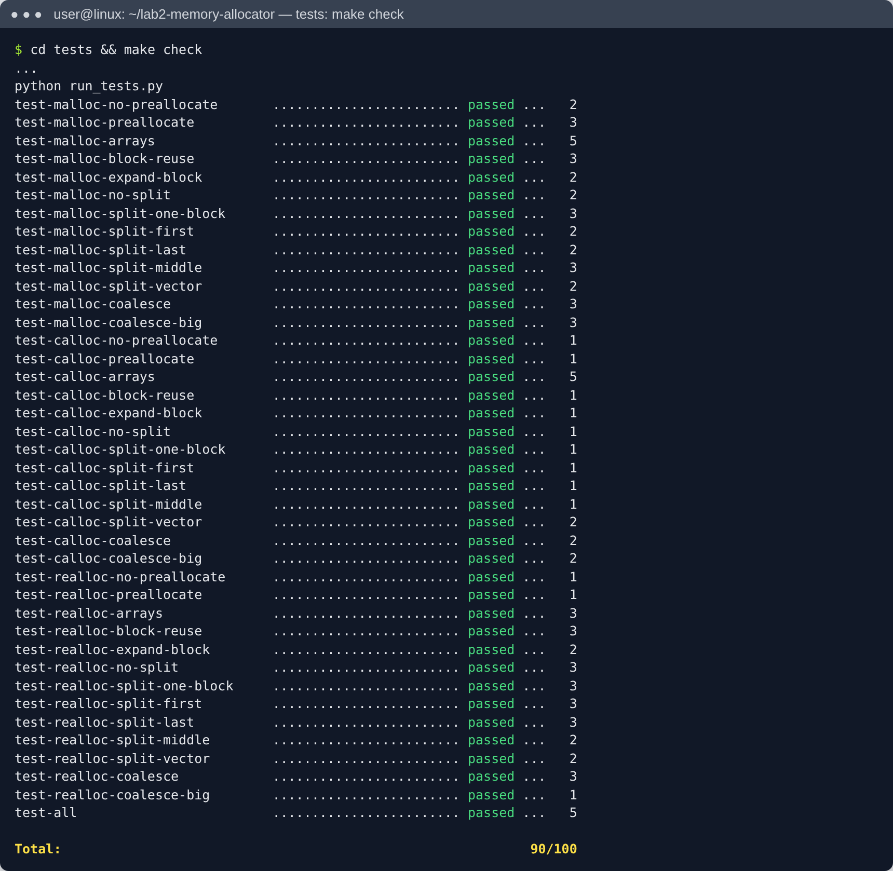

# Програмний проєкт 2: алокатор пам'яті

**Виконав:** Микулінський Артем Віталійович, група ТК-41

Мінімалістичний алокатор пам'яті мовою C: `os_malloc()`, `os_calloc()`, `os_realloc()`, `os_free()`.
Завдання: [open-education-hub / memory-allocator](https://github.com/open-education-hub/operating-systems/tree/main/content/assignments/memory-allocator).

Рішення лежить у файлі [`src/osmem.c`](src/osmem.c).

## Збирання та тести

Потрібні `gcc`, `make`, `python3`, `ltrace`, `valgrind`.

```bash
cd tests
make check          # збирання libosmem.so, тестів і запуск з перевіркою витоків (valgrind)
```

Результат: **усі 40 тестів пройдено, 90/100** (це максимум автоматичних тестів, решта 10 балів призначені для оцінки стилю коду).




## Як це працює

Кожен блок пам'яті починається зі структури `struct block_meta` (32 байти), за нею йдуть дані (payload). Користувач отримує адресу payload. Усі розміри вирівнюються до 8 байт.

| Ситуація | Що робить алокатор |
|---|---|
| `malloc`, блок (метадані + дані) ≥ 128 КБ | `mmap()`, статус `STATUS_MAPPED` |
| `calloc`, блок ≥ розміру сторінки (4096) | `mmap()` |
| Менші блоки | heap через `sbrk()`/`brk()` |
| Перше використання heap | **передвиділення** 128 КБ одним `sbrk()` |
| Пошук вільного блоку | спочатку **злиття** сусідніх вільних блоків, потім стратегія **find best** (найменший підходящий блок) |
| Вільний блок більший, ніж треба | **розбиття (split)**, якщо залишок вміщує метадані + 8 байт |
| Немає підходящого блоку, останній блок вільний | **розширення** останнього блоку через `sbrk()` на різницю |
| `free` для heap-блоку | лише позначка `STATUS_FREE` (пам'ять ОС не повертається) |
| `free` для mmap-блоку | `munmap()` |

### `os_realloc`
1. `ptr == NULL` дає `os_malloc(size)`; `size == 0` дає `os_free(ptr)`; для вільного блоку повертається `NULL`.
2. Якщо блок mmap-ований або новий розмір ≥ 128 КБ: виділити новий блок, скопіювати дані, звільнити старий.
3. Зменшення розміру: блок залишається на місці і за можливості розбивається.
4. Збільшення розміру:
   - якщо блок останній на heap, він розширюється через `sbrk()`;
   - інакше блок зливається з наступними вільними блоками **по одному**, і після кожного злиття перевіряється, чи вистачає місця (злиття не відкочуються);
   - якщо місця не вистачило, виділяється новий блок, дані копіюються, старий звільняється.

Кожен системний виклик перевіряється макросом `DIE()`.
